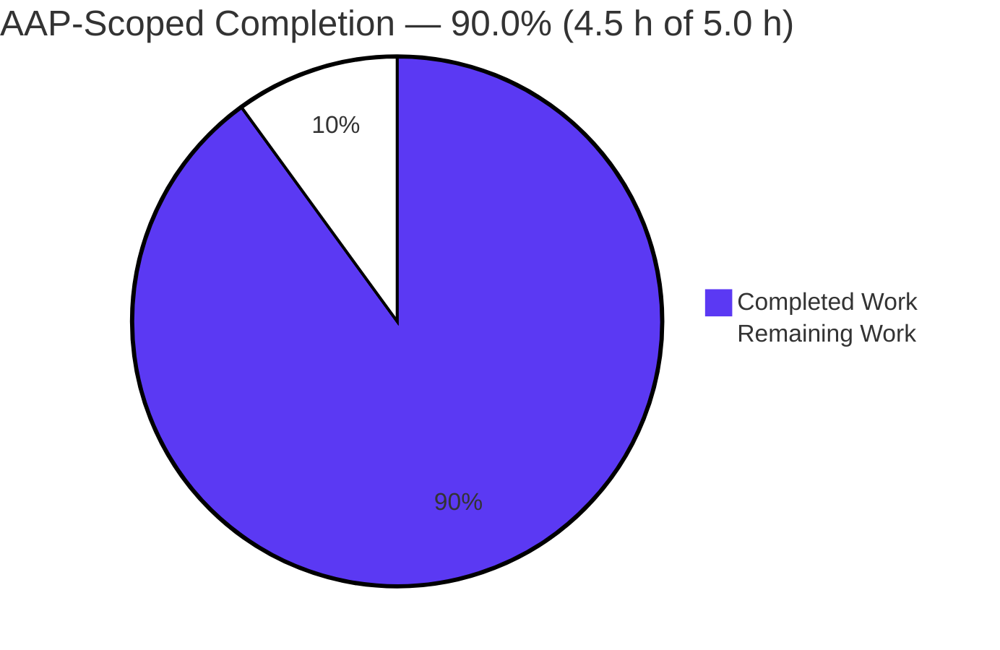

# 1. Executive Summary

Status: delivered and verified; 90.0% of scoped hours complete, with one runtime-provenance caveat.

## 1.1 Project Overview

`Welocme.js` is a Python 3 program at the repository root whose executable body is the single statement `print("Welcome to Blitzy")` and whose entire behaviour is to write the line `Welcome to Blitzy` to standard output and exit successfully; explanatory `#` comments above that statement record what the program does and why Python source lives in a `.js`-named file. It satisfies a four-part request: print that exact string, in Python, from a file named `Welocme.js` — misspelling and `.js` suffix preserved — and keep the code simple. The suffix names the file, not the language: CPython executes a path argument as source whatever its extension, so `python3 Welocme.js` runs it unmodified. There is no framework, dependency, service or deployment target; the only contract is the process boundary.

## 1.2 Completion Status

All 40 requirements the work was scoped against are delivered: 38 met outright, 2 with a documented caveat (Section 5.2). Of the 5.0 hours the scope represents, 4.5 are complete and 0.5 remain for runtime-provenance confirmation and final acceptance sign-off.

**Calculation: 4.5 ÷ (4.5 + 0.5) = 4.5 ÷ 5.0 = 90.0% complete.**



| Metric | Hours |
|--------|-------|
| Total Project Hours | 5.0 |
| Completed Hours (Baseline: Human with agentic-assist) | 4.5 |
| Remaining Hours | 0.5 |
| Completion | **90.0%** |

## 1.3 Key Accomplishments

- `Welocme.js` is at the repository root under the exact spelling and `.js` suffix the request fixed — the only file the work added.
- `python3 Welocme.js` writes exactly 18 bytes (`Welcome to Blitzy` plus one LF), nothing to stderr, and exits 0.
- Python in a `.js`-named file is proven at runtime: CPython executes the path as source, with no rename, wrapper or shim.
- Output is independent of working directory, invocation form, arguments, stdin and environment.
- Output is identical on every run, including 20 concurrent executions with no interleaving.
- Runs leave the repository untouched: no file written, no `__pycache__`, clean `git status`.

## 1.4 Critical Unresolved Issues

1 of the 40 AAP requirements is open as a caveat; 0 of the request's 4 directives is open. Nothing blocks release, and nothing built is left unexercised — the caveat is a runtime-provenance confirmation a human must make before sign-off.

| Issue | Impact | Owner | ETA |
|-------|--------|-------|-----|
| Runtime provenance: the program was built and verified on CPython 3.13.18, while the specification of record states 3.12.3 | None on behaviour — the single `print` call is valid on every Python 3.x and no version floor is claimed. A reader targeting another interpreter finds no pin in the repository, and the scope excludes adding one | Release owner | 0.25 h |

## 1.5 Access Issues

No access issues identified. Nothing beyond a CPython 3 interpreter on `PATH` — present, version 3.13.18 — is needed to build, run or verify this deliverable. No repository permission, service credential, database, network route, third-party API key or environment variable is involved, and none is missing.

## 1.6 Recommended Next Steps

1. **[High]** Confirm the target Python 3 runtime and run the acceptance command on it (0.25 h).
2. **[High]** Sign off the delivered bytes and close the delivery (0.25 h).
3. **[Medium]** Decide whether this deliverable should carry an automated acceptance gate; the scope excludes tests and pipelines, so it is new work.
4. **[Low]** Record that `Welocme.js` is Python despite its suffix and that the misspelt name is intentional, so neither is corrected later.

# 2. Project Hours Breakdown

Hours are counted only for what this scope defines: the deliverable and the verification that proves it. No path-to-production hours are outstanding, because the program has no deployment target, service, container, configuration, migration or data store.

## 2.1 Completed Work Detail

| Component | Hours | Description |
|-----------|-------|-------------|
| Deliverable implementation to the fixed body, byte properties and mode | 1.5 | The single `print("Welcome to Blitzy")` statement, preceded by 12 explanatory `#` comment lines, in `Welocme.js` at the repository root — 724 bytes over 13 lines, mode 644, ASCII, no BOM, no shebang, no trailing blank line; the comments are the sanctioned FR-4 departure recorded in Section 5.2 (AAP 0.6.1, 0.7.2, 0.9.1; FR-1–FR-4; D1–D4; 0.12.1 g1–g2) |
| Language/suffix conflict resolution and its runtime proof | 0.5 | Python source in a `.js`-named file, executed by path as `python3 Welocme.js` (AAP 0.1.2, 0.2.1) |
| Process-contract and invocation verification | 1.0 | Exit status, both streams, ignored arguments, unused stdin, working-directory and environment independence (AAP 0.6.1 key interfaces, 0.3.2, 0.3.3) |
| Determinism, concurrency and side-effect freedom | 0.5 | Repeated and 20-way concurrent runs producing identical bytes; no file written, no `__pycache__` (AAP 0.1.1 P1, 0.12.1 g3) |
| Acceptance gate and static gates | 0.5 | The documented 18-byte `cmp` gate plus the in-memory compile and AST checks (AAP 0.6.1 acceptance evidence, 0.12.1 g4, 0.12.2) |
| Repository hygiene and exclusion sweep | 0.5 | One added file, `README.md` untouched, every excluded artefact proven absent (AAP 0.7.1, 0.8.1, 0.8.2, 0.12.1 g3) |
| **Total** | **4.5** | Matches Completed Hours in Section 1.2 |

## 2.2 Remaining Work Detail

| Category | Hours | Priority |
|----------|-------|----------|
| Runtime-provenance confirmation and final acceptance sign-off — confirm the target Python 3 runtime, re-run the acceptance gate on it, and sign off the delivered bytes (AAP 0.3.1 with 0.6.1 acceptance; 0.12.2 acceptance) | 0.5 | High |
| **Total** | **0.5** | |

No other remaining work exists within scope. Every artefact the scope excludes — test suite, pipeline, manifest, lockfile, documentation file, shebang, executable bit, linter and formatter configuration — was excluded deliberately and is not outstanding work; adding any of it would be new scope requiring an explicit decision, and no hours are counted for it here.

## 2.3 Hours Calculation and Confidence

| Figure | Calculation | Value |
|--------|-------------|-------|
| Completed hours | 1.5 + 0.5 + 1.0 + 0.5 + 0.5 + 0.5 | 4.5 h |
| Remaining hours | two 15-minute tasks, each rounded up to the nearest 0.5 h | 0.5 h |
| Total project hours | 4.5 + 0.5 | 5.0 h |
| Completion | 4.5 ÷ 5.0 × 100 | 90.0% |
| Path-to-production hours outstanding | no deployment surface exists (AAP 0.1.3, 0.3.3, 0.6.2–0.6.4) | 0 h |

**Confidence: High.** The deliverable is 724 bytes over 13 lines — one executable statement plus its explanatory comments — every requirement is settled by a command whose expected output is fixed to the byte, and both remaining tasks are bounded human confirmations rather than engineering of unknown size. The estimate would move only if the target environment turns out not to supply a CPython 3 `python3` on `PATH`.

# 3. Test Results

Every number below is from a run of this repository on this host, under CPython 3.13.18. 48 checks were executed; 34 of them were executions of `python3 Welocme.js`. No coverage tool, linter or security scanner is configured, so no coverage percentage exists — the program holds one statement and no branch to cover.

| Area / Category | Framework | Tests | Passed | Failed | Coverage | What This Proves |
|-----------------|-----------|-------|--------|--------|----------|------------------|
| Acceptance and output contract | bash + CPython 3.13.18 | 6 | 6 | 0 | not configured | The program writes exactly the 18-byte line to stdout, byte-identical to `printf 'Welcome to Blitzy\n'`, with no leading or trailing bytes, empty stderr and exit status 0 |
| Invocation, arguments, stdin and environment | bash + CPython 3.13.18 | 6 | 6 | 0 | not configured | Output is unaffected by working directory, absolute versus relative path, an arbitrary argument list, piped or absent stdin, and an otherwise empty environment |
| Determinism and concurrency | bash + CPython 3.13.18 | 25 | 25 | 0 | not configured | Every run produces identical bytes — five sequential runs share one output hash and twenty concurrent runs produce 360 bytes in twenty lines with no interleaving |
| Static structure and syntax | CPython `compile`/AST + byte scan | 4 | 4 | 0 | not configured | The file parses as Python 3; the parsed module is one statement, `print("Welcome to Blitzy")`, preceded by 12 explanatory `#` comment lines within the delivered 13 lines and 724 bytes; ASCII, one LF, no CR, no BOM, no shebang, no trailing blank line |
| Repository state and scope exclusions | git | 5 | 5 | 0 | not configured | The change is exactly one added file, every excluded artefact is absent from the tree, and executions alter nothing |
| Boundary and negative contract | bash + CPython 3.13.18 | 2 | 2 | 0 | not configured | The file is a program and not a library — it cannot be imported by module name — and it is not directly executable, by design |
| **Total** | | **48** | **48** | **0** | | |

**Not Covered.** The following are not exercised by any test in this repository, and a human should weigh them before relying on the deliverable beyond its stated contract.

- **No automated test suite exists.** `python3 -m pytest --collect-only -q` collects 0 tests (exit 5). The acceptance command in Section 9 is the only gate, and it must be run by hand after any change; running it is the check, not a substitute for one.
- **Interpreters other than CPython 3.13.18 are untested.** A non-CPython `python3` alias or a Python 2 interpreter will break the contract, and nothing in the repository pins or checks the interpreter.
- **Platforms other than this Linux host are untested.** Line endings, console encoding and shell behaviour on Windows or macOS were not exercised; the file itself is a fixed ASCII byte sequence, so the exposure sits with the invoking shell rather than the program.
- **Unwritable stdout is outside the covered contract.** Redirecting to a full device exits 120 with `OSError: [Errno 28] No space left on device`, and a closed descriptor exits 0 with nothing observable. Neither was treated as a failing path, because the contract presumes a writable stdout.
- **Downstream consumers are unverified.** Nothing in the repository reads this program's output, so any parsing or assertion a caller adds is untested here.
- **No browser, HTTP, database, container or UI surface exists**, so nothing of that kind is covered — and none of it is missing.

# 4. Runtime Validation &amp; UI Verification

The deliverable's runtime surface is the process boundary, so the flows below are invocations. Each status reflects a run observed on this host under CPython 3.13.18.

- ✅ **Execution and exit status** — `python3 Welocme.js` prints one line and exits 0.
- ✅ **Output bytes** — 18 bytes, first byte `W` (0x57), last byte LF (0x0a), byte-identical to `printf 'Welcome to Blitzy\n'`; a merged `>file 2>&1` capture is still exactly 18 bytes.
- ✅ **Stream separation** — standard error receives 0 bytes; no traceback, path or version leaks into either stream.
- ✅ **Invocation forms** — from the repository root, from the parent directory and by absolute path: identical bytes in all three.
- ✅ **Arguments ignored** — a mixed list of flag-like values (`--help`, `-h`, `--version`, `help`), unicode and extra operands leaves the output unchanged; no usage text is printed, by design.
- ✅ **Standard input unused** — an empty input stream and piped text both leave the output unchanged.
- ✅ **Environment independence** — run under `env -i` with only `PATH` set: identical bytes.
- ✅ **Determinism and concurrency** — five sequential runs share one output hash; twenty concurrent runs produce 360 bytes in twenty lines, all exit 0, no interleaving.
- ✅ **Side-effect freedom** — after every run the working tree is unchanged: no file written, no `__pycache__`, no `.pyc`, `git status` clean.
- ⚠ **Never exercised at runtime** — any interpreter other than CPython 3.13.18, any operating system other than this Linux host, and an unwritable stdout (full device or closed descriptor).

**Not applicable:** there is no browser, HTML, HTTP endpoint, server, database, container or screen anywhere in the tree, so no interface, navigation or visual state exists to verify and no screenshot or recording applies. There are no failing flows.

# 5. Compliance & Quality Review

The review below reports the state each deliverable stands in now, against the quality and compliance benchmarks this work was held to.

## 5.1 Compliance Matrix

| Deliverable | Benchmark | Status | Evidence |
|-------------|-----------|--------|----------|
| FR-1 — the printed line | Functional correctness | ✅ PASS | 18 bytes byte-identical to `printf 'Welcome to Blitzy\n'`; nothing before or after; empty stderr; exit 0 |
| FR-2 — Python 3 source | Language and runtime | ✅ PASS | Parses and compiles as Python 3; executed by CPython on every run |
| FR-3 — exact file name and location | Naming and structure | ✅ PASS | `Welocme.js` at the repository root; no `Welcome.js`, `welocme.js` or `Welocme.py` variant exists |
| FR-4 — simplicity | Code quality | ✅ PASS | One executable statement, one builtin, no imports, functions, classes or docstrings; explanatory `#` comments are the only addition to the body, a sanctioned departure from FR-4's comment clause recorded in Section 5.2 |
| D1–D4 with the Python/`.js` resolution | Requirements traceability | ✅ PASS | Every user directive met and both conflicting directives kept as written |
| AAP 0.6.1 — body and file properties | Byte-level fidelity | ✅ PASS | 724 bytes over 13 lines, 12 of them explanatory `#` comment lines: ASCII, exactly one LF, no CR, no BOM, no shebang, no trailing blank line; the single-line and 27-byte properties are superseded per Section 5.2 |
| AAP 0.6.1 — process contract | Interface conformance | ✅ PASS | Exit 0, 18-byte stdout, empty stderr, arguments ignored, stdin unused, not importable by module name |
| AAP 0.7.1/0.7.2/0.9.1 — structure and mapped paths | Scope discipline | ✅ PASS | One CREATE under the mapped plan (`Welocme.js`); the only other path written is this guide, added as documentation and then aligned to the delivered file under the human comment request (Section 5.2), while `README.md` stays byte-unchanged. Nothing else was created, moved or deleted |
| AAP 0.8.2 — exclusions | Scope discipline | ✅ PASS | 45-path sweep: no test, manifest, lockfile, pipeline, container, linter, documentation or design artefact present |
| AAP 0.4.1 — dependencies | Supply chain | ✅ PASS | Zero imports and zero manifests, so there is no package, advisory or version to audit |
| Code hygiene | Maintainability | ✅ PASS | No TODO, FIXME, placeholder, stub, dead code or commented-out block; no unreachable branch |
| AAP 0.3.1 — runtime provenance | Environment conformance | ⚠ PARTIAL | Built and verified on CPython 3.13.18; the specification of record states 3.12.3 (Section 5.2) |

## 5.2 AAP & Rule Divergences and Gaps

No user rules were supplied for this project, so no divergence from a user rule exists or can exist. Three departures between the agreed specification and what was delivered are recorded below; two of them are sanctioned — one by the human review of the delivered pull request and one by the environment's own instructions — and none of the three affects behaviour.

| What the AAP/Rule Required | What Was Delivered Instead | Why It Diverged | Impact | Remediation |
|----------------------------|----------------------------|-----------------|--------|-------------|
| AAP 0.3.1 records the runtime as CPython 3.12.3 ("verified on 3.12.3"), and AAP 0.6.1 makes the acceptance run the sole completion criterion | The program runs, and was verified, on CPython 3.13.18 — the `python3` on this host's `PATH` — with identical behaviour | The specification's environment record was taken from a different image; the same section states "no narrower version floor is claimed and none is needed", and no edit to a one-statement script can change a host interpreter | None on behaviour: the call is valid on every Python 3.x. A reader targeting another interpreter finds no pin in the repository, and a manifest is excluded by scope | Confirm the target runtime and re-run the acceptance gate on it (0.5 h) |
| AAP 0.7.1 states the delivered structure is "one file, no directories, nothing else created", and describes the root as empty at the start of the work | The root also holds a pre-existing 46-byte `README.md`, byte-unchanged, and two empty untracked directories, `blitzy/screenshots` and `blitzy/screen_recordings` | Those paths pre-dated the work, and the environment's own instructions require leaving them alone — a sanctioned departure, with that instruction as the reason | None: the work's own diff is exactly one added file, and the extra entries are inert | None — do not delete `README.md` to match the sketch |
| AAP 0.1.1 FR-4 requires one statement and "no imports, functions, classes, argument parsing, configuration, environment reads or comments", and AAP 0.6.1 specifies the file properties as "a single line of ASCII text terminated by one LF newline" | The delivered file carries explanatory `#` comments above the unchanged statement: 724 bytes over 13 lines, 12 of them comment lines, the parsed module still one statement, ASCII, exactly one LF, no CR, no BOM, no shebang, no trailing blank line, mode 644 | The human review of the delivered pull request asked for explanatory comments in the code ("Add proper comments for the code in the files"); that request supersedes both clauses rather than being narrowed by them, and this guide's statements about the file were aligned to the delivered shape | None on behaviour: the acceptance evidence is unchanged — 18-byte stdout byte-identical to `printf 'Welcome to Blitzy\n'`, 0-byte stderr and exit status 0, observed here on CPython 3.13.18 — and the executable body is still the single `print` call | None — delivered and closed; a future change keeps the comments and adds no import, function or argument handling |

**Runtime provenance.** The one caveat on an otherwise complete delivery is the provenance of the interpreter. Every result reported here — the 18-byte line, the empty stderr, the zero exit status — was produced on CPython 3.13.18, while the specification of record names 3.12.3. Nothing in `Welocme.js:13` depends on the difference: `print` takes one string argument and ends the line with `\n` on every Python 3 release, and the file is a single call with no branch and no version check. The remaining step is small but real. If 3.12.3 is the runtime you must support, run the acceptance command in Section 9 there and record the result; if 3.13.18 is the target, record that. Until one of those is done the repository pins no interpreter at all, because a manifest is excluded by scope.

# 6. Risk Assessment

Risks below are forward-looking: what could still go wrong once this deliverable is relied upon. Every risk is accepted rather than outstanding — each one follows from a decision this work was required to make, and none is a defect in the code as delivered.

| Risk | Category | Severity | Probability | Mitigation | Status |
|------|----------|----------|-------------|------------|--------|
| The `.js` suffix on Python source misleads suffix-based tooling — editors, `*.js` globs and Node runners treat the file as JavaScript | Technical | Low | High | Documented here and in the run instructions; the file is invoked only as `python3 Welocme.js`, never through a Node runtime | Accepted, permanent by design |
| The misspelt name `Welocme` reads as a defect and invites a "correcting" rename that breaks the fixed path and the documented command | Technical | Low | Medium | Recorded as intentional in Sections 1.3 and 9; the path is part of the request and must not change | Accepted |
| Nothing in the repository pins the interpreter or declares dependencies, so the contract holds only for a CPython 3 `python3` on `PATH` | Operational | Low | Low | Prerequisites name CPython 3 (validated on 3.13.18); the acceptance gate confirms the runtime before use | Open, accepted |
| No automated regression gate exists — no test suite, no pipeline — so a future edit is unverified until someone runs the acceptance command | Operational | Medium | Medium | Run the Section 9 acceptance command after any change; adding a suite or pipeline is new scope and needs a deliberate decision | Open, accepted |
| The program validates nothing and reports nothing, so a downstream consumer must assert on the bytes itself | Integration | Low | Medium | Document the expected bytes and exit status; compare with `cmp` against `printf 'Welcome to Blitzy\n'` rather than a shell variable, which drops the trailing newline | Open, accepted |
| An unwritable stdout makes the run fail or produce nothing — a full device exits 120, a closed descriptor exits 0 silently | Integration | Low | Low | Treat as environment behaviour: the contract presumes a writable stdout | Accepted |

**Security:** no security risk is identified and none can arise without new code. The program reads no input, holds no credentials, touches no file, socket or subprocess, imports nothing and emits one fixed string; the only exposure of that string is the deliverable's purpose.

# 7. Visual Project Status


Chart colours throughout: Completed Work = Dark Blue `#5B39F3` (4.5 h); Remaining Work = White `#FFFFFF` (0.5 h); headings and accents = Violet-Black `#B23AF2`; highlight accent = Mint `#A8FDD9`.

**Requirement status** — 40 requirements in scope.

| Status | Count | Share |
|--------|-------|-------|
| ✅ Completed | 40 | 100% |
| ⚠ Partially Completed | 0 | 0% |
| ❌ Not Started | 0 | 0% |

Two of the 40 are completed with a documented caveat rather than outright (Section 5.2): the interpreter a reader must target, and the description of the root contents.

**Remaining work by priority** — 0.5 h total.

| Priority | Hours | Items |
|----------|-------|-------|
| High | 0.5 | Runtime-provenance confirmation and final acceptance sign-off |
| Medium | 0 | None estimated; the open decisions (automated gate, permanent naming) are scope choices, not engineering work |
| Low | 0 | None estimated; documentation notes need no engineering time |

# 8. Summary &amp; Recommendations

**What was delivered.** `Welocme.js` — a Python 3 program at the repository root whose executable body is the single statement `print("Welcome to Blitzy")`, whose entire behaviour is to write `Welcome to Blitzy` to standard output and exit successfully, and which carries explanatory `#` comments above that statement. It satisfies a request with two directives in tension: the source must be Python, and the file must be named `Welocme.js`. Both are kept exactly as written, because CPython executes a path argument as source whatever its extension, so `python3 Welocme.js` runs the file with no rename, wrapper, shim or `package.json`. The file is 724 bytes over 13 lines, 12 of them explanatory `#` comment lines: ASCII, one terminating LF, no BOM, no shebang, mode 644.

**What was exercised to prove it.** 48 checks were run, 34 of them executions of the program. `python3 Welocme.js` emits exactly 18 bytes — `Welcome to Blitzy` plus one newline — that compare byte-identical to `printf 'Welcome to Blitzy\n'`, writes nothing to standard error and exits 0. The same bytes appear when the program is run from another directory, by absolute path, with an arbitrary argument list, with piped or absent stdin, and under an empty environment. Five sequential runs share one output hash and twenty concurrent runs produce 360 bytes in twenty lines with no interleaving, and after all of them the working tree is unchanged: no file written, no `__pycache__`, clean `git status`. The static gates confirm the file compiles as Python 3, that its parsed module is the single statement `print("Welcome to Blitzy")`, and that the explanatory `#` comments above it leave the output unchanged.

**What remains.** Of the 5.0 hours this scope represents, 4.5 are complete and 0.5 remain — **90.0% complete**. All 40 requirements are delivered; 38 are met outright and 2 are met with a caveat. The outstanding half hour is not unfinished functionality: it is confirming which Python 3 runtime the deliverable must target, since everything here was built and verified on CPython 3.13.18 while the specification of record names 3.12.3, plus the human sign-off that closes the delivery. No path-to-production work is outstanding, because the program has no service, dependency, configuration, migration or deployment surface to stand up.

**Critical path and success metrics.** The path to a closed delivery is three steps: confirm the target runtime, run the acceptance command from Section 9 on it, and record the sign-off. Success is measurable to the byte — 18 bytes on stdout, 0 bytes on stderr, exit status 0, and a repository that is byte-for-byte unchanged after every run.

| Metric | Target | Observed |
|--------|--------|----------|
| Stdout | 18 bytes, `Welcome to Blitzy` + LF | 18 bytes, byte-identical to the reference |
| Stderr | 0 bytes | 0 bytes |
| Exit status | 0 | 0 |
| Repository side effects | none | none — no file, no `__pycache__`, clean `git status` |
| Files added by the work | 1 | 1 (`Welocme.js`) |

**Production readiness: ready for the purpose it defines.** This is a runnable file, not a service, so readiness means the documented invocation produces the documented bytes on a CPython 3 interpreter — which it does, repeatably, from any directory and under any input or environment. Three things should stay on a maintainer's mind, all of them recorded rather than hidden: the `.js` suffix will make suffix-driven tooling think the file is JavaScript, the misspelt name is intentional and must not be "corrected", and there is no automated regression gate, so the acceptance command is the check every future change must pass.

# 9. Development Guide

**System prerequisites.** A CPython 3 interpreter reachable as `python3` on `PATH` — validated on Python 3.13.18; the single `print` call is valid on every Python 3.x, so no narrower version floor applies. `git` (2.56.1 here) is needed only to inspect history. Nothing else: no Node.js, no package manager, no database, no container, no service, no port, no environment variable and no credential is involved.

**Environment setup and dependencies.** There is nothing to install and nothing to configure. The dependency set is empty — the program uses only the interpreter's own `print` builtin — so there is no manifest, no lockfile, no virtual environment and no `.env` file. Do not create any of them: adding one would declare an empty dependency set and would change a repository whose only deliverable is one file.

**Run the program.** From the repository root:

```bash
cd <repository-root>
python3 Welocme.js
```

Expected output — exactly this one line, 18 bytes including the newline, nothing on stderr, exit status 0:

```text
Welcome to Blitzy
```

**Verify the acceptance gate.** This is the project's entire gate and the command to run after any change. It passes when it prints `0`:

```bash
[ "$(python3 Welocme.js | wc -c)" = 18 ] && python3 Welocme.js | cmp - <(printf 'Welcome to Blitzy\n'); echo "gate=$?"
```

The explicit form below shows the same facts separately — exit status, byte counts of both streams, and a byte comparison against the reference:

```bash
python3 Welocme.js > out.bin 2> err.bin; echo "exit=$?"; wc -c out.bin err.bin; cmp <(printf 'Welcome to Blitzy\n') out.bin
```

Expected: `exit=0`, `18 out.bin`, `0 err.bin`, and no output from `cmp`. Delete `out.bin` and `err.bin` afterwards; they are capture files, not part of the repository.

**Syntax gate without artefacts.** Confirms the file compiles as Python 3 in memory, writing no `__pycache__` and no `.pyc`:

```bash
python3 -c "compile(open('Welocme.js').read(),'Welocme.js','exec')"; echo "syntax=$?"
```

**Whole-package gate.** The acceptance command above *is* the whole-package gate. No test suite, coverage target, linter, formatter or security scan is configured: `python3 -m pytest --collect-only -q` collects 0 tests and exits 5, which is expected. Do not read that as a failing build.

**Example usage.** The program is a plain filter with a fixed output, so it composes like one:

```bash
# Read the exact bytes, including the newline
python3 Welocme.js | od -An -c

# Count the output line
python3 Welocme.js | wc -l          # 1

# Run it from the parent directory by absolute path
cd .. && python3 "$OLDPWD/Welocme.js"

# Confirm the repository is untouched after a run
git status --porcelain --untracked-files=all   # no output
```

**Troubleshooting.**

| Symptom | Cause | Resolution |
|---------|-------|------------|
| `./Welocme.js` prints `Permission denied` and exits 126 | The file has no shebang and no executable bit, by design | Always invoke the interpreter: `python3 Welocme.js` |
| `python3: can't open file '.../Welocme.py'` and exits 2 | There is no `.py` twin, and none may be created | Use the `.js` name exactly as delivered; do not rename the file |
| `ModuleNotFoundError: No module named 'Welocme'` | The file is a program, not a library; `.js` is not an import suffix | Run it as a script rather than importing it |
| A pipeline reports status 141 with `set -o pipefail` | Upstream producers take SIGPIPE because stdin is never read; the program itself exits 0 | Inspect `PIPESTATUS`, or run the program without upstream producers |
| Capturing the output into a shell variable yields 17 characters | Command substitution strips the trailing newline | Compare bytes with `cmp` against `printf 'Welcome to Blitzy\n'` instead |
| `OSError: [Errno 28] No space left on device` with exit 120 | Standard output is unwritable, for example a full device | Redirect to a normal file; the contract presumes a writable stdout |
| `pytest` exits 5 with "no tests collected" | No test suite exists, by scope | Run the acceptance gate; treat the pytest result as expected |
| An editor or Node runtime reports a JavaScript syntax error | Suffix-driven tooling treats `.js` as the language | Open the file as Python and run it with `python3` |
| `git status` shows new files after experimenting | Capture files written into the checkout | Write captures outside the repository, or delete them afterwards |

**Guard rails for future changes.** Keep `Welocme.js` at the repository root under its exact spelling and suffix; keep the body a single `print` call with no imports, functions or argument handling — the explanatory comments above it are permitted and are the only addition to the original body; do not add a manifest, lockfile, `.gitignore`, CI workflow, container file, linter config or documentation file; and treat `README.md` and the two empty `blitzy/` directories as pre-existing surroundings to leave alone.

# 10. Appendices

Supporting references for running, verifying and maintaining this deliverable. Each appendix below has content relevant to this project; appendices that would be empty for it are omitted.

## A. Command Reference

| Command | Purpose | Expected result |
|---------|---------|-----------------|
| `python3 Welocme.js` | Run the deliverable | One line, `Welcome to Blitzy`, on stdout; exit 0 |
| `python3 Welocme.js > out.bin 2> err.bin` | Capture both streams separately | `out.bin` 18 bytes, `err.bin` 0 bytes |
| `[ "$(python3 Welocme.js \| wc -c)" = 18 ] && python3 Welocme.js \| cmp - <(printf 'Welcome to Blitzy\n')` | Acceptance gate | Exit 0, no output |
| `cmp <(printf 'Welcome to Blitzy\n') out.bin` | Compare bytes against the reference | No output when identical |
| `od -An -c out.bin` | Inspect the exact byte sequence | `W e l c o m e   t o   B l i t z y \n` |
| `python3 -c "compile(open('Welocme.js').read(),'Welocme.js','exec')"` | Syntax gate with no artefacts | Exit 0, nothing written |
| `python3 Welocme.js \| wc -l` | Count output lines | `1` |
| `wc -c Welocme.js` | File size | `724 Welocme.js` |
| `sha256sum Welocme.js` | File identity | `97f5296de8f64dc9634583e7a18a40ca8a1a4e4e254a1f4b4a59e2057efc8a10  Welocme.js` |
| `git status --porcelain --untracked-files=all` | Confirm a run changed nothing | No output |
| `git diff --stat origin/main...HEAD -- Welocme.js` | See the deliverable's change set | `Welocme.js \| 13 +`, 1 file changed, 13 insertions(+) |
| `python3 -m pytest --collect-only -q` | Confirm no test suite is configured | "no tests collected", exit 5 |
| `python3 --version` | Confirm the interpreter | `Python 3.13.18` on the validation host |

## B. Port Reference

The program binds no TCP or UDP port, opens no socket, listens on nothing and connects to nothing — it writes one fixed line to standard output and exits. Nothing in the repository declares a port, and no service manager, reverse proxy or firewall rule is involved.

| Port | Protocol | Used by | Notes |
|------|----------|---------|-------|
| none | — | — | No listener, no client and no network call exists in `Welocme.js` |

Consequences worth knowing: several copies of the repository can run the same command concurrently without colliding (verified with 20 simultaneous runs), and no port conflict can prevent the program from working.

## C. Key File Locations

| Path | Role | Present |
|------|------|---------|
| `Welocme.js` | The entire deliverable: Python 3 source, one executable statement plus explanatory comments, 724 bytes over 13 lines, mode 644 | Yes — added by the work |
| `README.md` | Pre-existing repository readme, 46 bytes, unrelated to the deliverable | Yes — unchanged by the work |
| `blitzy/screenshots/` | Pre-existing empty artefact directory | Yes — empty, untouched |
| `blitzy/screen_recordings/` | Pre-existing empty artefact directory | Yes — empty, untouched |
| `requirements.txt`, `pyproject.toml`, `setup.py`, `package.json` | Not used — the dependency set is empty | No — and none should be added |
| `tests/`, `.github/`, `Dockerfile` | Not used — no test suite, pipeline or container exists | No — and none should be added |

## D. Technology Versions

| Component | Version on the validation host | Notes |
|-----------|-------------------------------|-------|
| CPython (`python3`) | 3.13.18 | Any Python 3.x runs the program; 3.12.3 is the version the specification of record states |
| git | 2.56.1 | Needed only to inspect history and confirm a clean tree |
| pytest | 9.2.0, present on the host | Not a project dependency; it collects 0 tests here |
| Node.js / npm | v22.23.5 / 11.21.3, present on the host | Not used — the `.js` suffix is a file name, not a language or a toolchain |
| Third-party Python packages | none | The program imports nothing |

## E. Environment Variable Reference

The program reads no environment variable, and the repository declares none. Verified during validation: the run produces identical bytes under `env -i` with only `PATH` set, and it neither reads configuration nor consults a locale.

| Variable | Required | Purpose | Behaviour if unset |
|----------|----------|---------|--------------------|
| `PATH` | Yes | Locate the `python3` executable that runs the file | The command is not found; supply the interpreter path explicitly if needed |
| Any other variable | No | None are read | No effect — output is fixed regardless |

## F. Developer Tools Guide

| Tool | Role in this project | Notes |
|------|---------------------|-------|
| `python3` | Sole prerequisite and runner | Executes `Welocme.js` as source by path despite the `.js` suffix |
| `cmp` | Byte comparison against the reference line | Part of coreutils; the acceptance gate depends on it, including process substitution with `<( … )` |
| `wc -c`, `wc -l` | Byte and line counts of the output | Used by the acceptance gate and the byte-budget checks |
| `od` | Byte-level inspection of output and file | `od -An -c out.bin` shows the exact 18 bytes |
| `sha256sum` | File identity check | Detects any accidental edit to the 724-byte file |
| `git` | History, change set and side-effect checks | `git status --porcelain --untracked-files=all` confirms a run changed nothing |
| `pytest` | Not used as a project gate | Collects 0 tests by scope; its exit status 5 is expected |
| `node` / `npm` | Not used at all | Present on the host, but the `.js` suffix does not make this a Node project |

No build tool, bundler, transpiler, formatter or linter is part of this project's workflow, and none should be added.

## G. Glossary

| Term | Meaning in this guide |
|------|----------------------|
| AAP | Agent Action Plan — the technical specification of record that defines this work's requirements, referenced by section number (for example AAP 0.6.1) |
| Byte-identical | The same bytes in the same order; asserted here with `cmp` against `printf 'Welcome to Blitzy\n'` |
| LF | Line feed, byte `0x0A`. The file ends with exactly one; the program's output ends with exactly one |
| BOM | Byte-order mark (`EF BB BF`). Absent from the file, as required |
| Shebang | A leading `#!` interpreter line. Absent by design; the file is run as `python3 Welocme.js` |
| Executable bit | The filesystem permission that allows `./Welocme.js`. Deliberately unset, so direct execution exits 126 |
| Process contract | The only interface this program has: arguments ignored, stdin unused, 18 bytes on stdout, empty stderr, exit 0 |
| Acceptance gate | The single documented command that proves the contract: 18-byte stdout compared with `cmp` against the reference line |
| Path dispatch | CPython's behaviour of executing a path argument as Python source regardless of the file's extension — the reason a `.js` file can hold Python |
| Sanctioned departure | A divergence that a higher-ranking instruction requires, such as leaving a pre-existing `README.md` untouched |
| Path-to-production work | Deployment, configuration or infrastructure work needed to run the deliverable in its target environment. Zero here: the program has no such surface |
